 

---

## About

I build cross-platform apps with **Flutter and Dart**, write **C++** for logic-heavy problems, and create **web projects** from idea to deployment. I am also learning **Python** and I code, create and learn every day.

I approach work with a simple routine: understand the problem, simplify it, then build it cleanly.

| | |
| --- | --- |
| **Name** | Waqas Ahmad |
| **Core stack** | Flutter, Dart, C++, Web |
| **Learning** | Python, software architecture, app performance |
| **Based in** | Pakistan |
| **Open to** | Collaboration, freelance projects, internships |

## Skills

  

## Activity

Calculated automatically from my GitHub account, refreshed twice a day.

 

 

<picture>
  <source media="(prefers-color-scheme: dark)" srcset="https://raw.githubusercontent.com/Waqas-Ahmad199/Waqas-Ahmad199/output/github-snake-dark.svg">
  
</picture>

## Let's work together

Have an app, a website or an idea that needs building? Reach out through my GitHub profile: [**Waqas-Ahmad199**](https://github.com/Waqas-Ahmad199).

